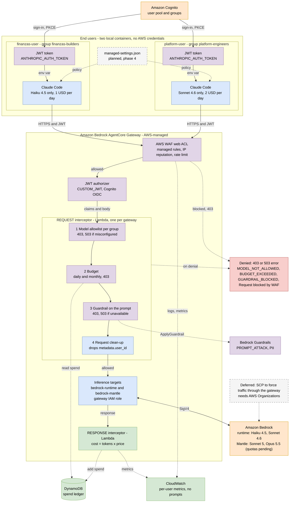

# AWS Claude Code Governance

Governed access to **Claude Code** on **Amazon Bedrock**: users reach Claude models only through an **Amazon Bedrock AgentCore Gateway** (AWS-managed), which enforces **identity, per-user budgets, a model allowlist per group and Bedrock Guardrails** on every request. Users hold a gateway token tied to a Cognito group, never Bedrock credentials.

> **Status:** deployed through phase 3 (gateway, interceptors, guardrail, two user profiles) and **verified end to end**: Claude Code answered through the gateway for both seats on 2026-10-22, the spend was recorded per user and a real-spend budget block was observed ([evidence](evidence/2026-10-22-end-to-end.md)). The models are served by a second inference target on `bedrock-runtime` (Haiku 4.5, Sonnet 4.6) because the Mantle quotas for the newer Claude models are applied at 0; the increase requests are still pending ([docs/model-access-request.md](docs/model-access-request.md), [docs/model-availability.md](docs/model-availability.md)). See [Phases](#phases).

## Architecture



Purple = security control, blue = service, green = spend tracking, orange = external, red = denial, dashed grey = deferred.

Images for presentations: [overview](docs/architecture-overview.png) and [full diagram](docs/architecture.png); the Mermaid sources are in `docs/diagrams/`.

**What is native and what is custom.** The gateway itself provides the JWT authorizer, routing to the inference target by the `model` field and native rate limits ([docs](https://docs.aws.amazon.com/bedrock-agentcore/latest/devguide/gateway-rate-limits.html)). It has no per-user dollar budgets or model entitlements per group: those are the **interceptors**, AWS's documented extension point ([Using interceptors with Gateway](https://docs.aws.amazon.com/bedrock-agentcore/latest/devguide/gateway-interceptors.html)), backed here by the DynamoDB spend ledger of the AWS sample. See [ADR-012](docs/decisions.md) and, for what AWS offers natively and the published alternatives, [docs/native-options.md](docs/native-options.md).

The gateway endpoint is public and protected by AWS WAF, the JWT authorizer and the interceptors in that order ([docs/network-access.md](docs/network-access.md)).

A gateway accepts at most **one REQUEST and one RESPONSE interceptor**, so the model allowlist, the budget check and the guardrail all run in the same REQUEST Lambda, in that order (cheap checks first, the network call to the guardrail last). Through an inference target Bedrock records the **gateway's IAM role** as the caller, so per-user identity exists only in the interceptors (the claims of the Cognito token): Bedrock's own cost attribution tells you who spent after the fact, the gateway decides who can spend at all.

The baseline is the AWS sample [`sample-agentcore-gateway-usage-interceptor`](https://github.com/aws-samples/sample-agentcore-gateway-usage-interceptor) (CloudFormation, MIT-0), pinned to a commit. Its REQUEST Lambda is inline in the template, so `scripts/build_interceptor.py` patches it at build time with two hooks and packages the extensions in `interceptor/extensions/`; the sample is not forked. Design rationale: [docs/decisions.md](docs/decisions.md).

## Resources deployed

The baseline stack (the AWS sample, deployed as-is in phase 1) and what this repo adds.

| Resource | Purpose | Docs |
|---|---|---|
| AgentCore Gateway + inference target | Single entry point for `/v1/messages`; routes to Bedrock Mantle with the gateway's IAM role | [Gateway core concepts](https://docs.aws.amazon.com/bedrock-agentcore/latest/devguide/gateway-core-concepts.html) |
| Cognito user pool, app client (PKCE) and domain | Identity of the business user (`finanzas-user`) and its group (`finanzas-builders`); the gateway's `CUSTOM_JWT` authorizer trusts its OIDC discovery URL | [Amazon Cognito](https://docs.aws.amazon.com/cognito/latest/developerguide/what-is-amazon-cognito.html) |
| REQUEST interceptor (Lambda, `live` alias) | Budget check from the sample; **patched here** with the per-group model allowlist and the guardrail call | [Interceptors](https://docs.aws.amazon.com/bedrock-agentcore/latest/devguide/gateway-interceptors.html) |
| RESPONSE interceptor (Lambda, `live` alias) | Prices the response (tokens × price table) and adds it to the user's spend | [Interceptor payload types](https://docs.aws.amazon.com/bedrock-agentcore/latest/devguide/gateway-interceptors-types.html) |
| DynamoDB spend table and request-context table | Per-user spend and caps; short-lived identity stash that links a request to its response | [Amazon DynamoDB](https://docs.aws.amazon.com/amazondynamodb/latest/developerguide/Introduction.html) |
| KMS key, rollover Lambda, EventBridge schedules, S3 archive bucket, DLQ, alarms | Daily and monthly rollover of the spend counters, archived to a versioned bucket | [AWS KMS](https://docs.aws.amazon.com/kms/latest/developerguide/overview.html) |
| AWS WAF web ACL, its logging and 3 alarms (`infra/waf.yaml`) | Regional web ACL associated with the gateway: per-IP rate limit, IP reputation list, known-bad-inputs and common rule sets from AWS Managed Rules; logs redact the credentials; blocked requests get 403 `Request blocked by WAF` | [Protecting your gateway with AWS WAF](https://docs.aws.amazon.com/bedrock-agentcore/latest/devguide/gateway-waf.html) |
| Bedrock Guardrail (`policies/guardrail.json`) | Blocks prompt attacks and sensitive data (card numbers, AWS keys, passwords) in the user's prompt; phase 3 | [Guardrails](https://docs.aws.amazon.com/bedrock/latest/userguide/guardrails.html) |
| Inline IAM policy on the interceptor role | `bedrock:ApplyGuardrail` on that one guardrail only (`scripts/grant-guardrail.sh`) | [ApplyGuardrail](https://docs.aws.amazon.com/bedrock/latest/userguide/guardrails-use-independent-api.html) |
| `managed-settings.json` on the developer machine | Disables bypass and auto permission modes; denies `.env`, `~/.aws` and `aws *`; phase 4 | [Managed settings](https://code.claude.com/docs/en/managed-settings) |

Controls that are **in place by design**: AWS WAF at the edge (known bad inputs, IP reputation, per-IP rate limit); no AWS credentials for the end users (their containers hold none); gateway token required; per-group model allowlist (deny by default); daily and monthly budget; prompt scanning with fail-closed behavior; no prompts, bodies or headers in logs. The gateway has two inference targets: `bedrock-mantle` (the sample's connector) and `bedrock-runtime` (added by `scripts/add-runtime-target.sh`, provider-based, Messages API route, signed with the gateway role). Claude Code's `metadata.user_id` is rejected by the runtime route, so the REQUEST interceptor strips it ([ADR-013](docs/decisions.md)). Which models the account can reach is in [docs/model-availability.md](docs/model-availability.md) (`scripts/check-model-access.sh` regenerates it); the quota situation is `scripts/check-model-quotas.sh`. Known limits are in [docs/risks.md](docs/risks.md): the budget is checked before the call but charged after (one request can overshoot), indirect prompt injection through tool results is not scanned, and prompts that dictate the exact answer ("reply with only ...") can trip the guardrail.

## SCP vs Bedrock Guardrails

Different jobs, best used together ([details](docs/scp-vs-guardrails.md)). **Bedrock Guardrails** judge the *content* of a request (prompt attacks, sensitive data) and are deployed and tested here: 7 of 7 attacks blocked, 7 of 8 normal prompts passed, one known false positive and one confirmed gap (an injection inside a tool result is not scanned) ([evidence](evidence/2026-10-22-guardrails.md)). An **SCP** decides which *principals* may call which AWS *APIs*: it is the only control that can stop someone from calling Bedrock directly and skipping the gateway, and it can require a guardrail on direct calls with the `bedrock:GuardrailIdentifier` condition key. It needs AWS Organizations, which this account does not have, so the policies in `policies/` are **references that were not tested**.

| | Bedrock Guardrails | SCP |
|---|---|---|
| Question it answers | Is this content acceptable? | May this principal call this API? |
| Reads the content | Yes | No |
| Stops direct calls that bypass the gateway | No | Yes |
| Status here | Deployed and tested | Reference policies, not tested (no Organizations) |

## End users

Two user profiles consume the gateway, each from its own **container** (`containers/Dockerfile`: a clean Amazon Linux 2023 box with Claude Code and **no AWS credentials**, only a gateway token). They differ only in their Cognito group, which is what the REQUEST interceptor reads to decide the allowed model (one model per seat, in the manner of licence tiers), while the daily and monthly caps are per-user rows in the spend table. Prices for every routable model live in `config/price-table.json` and are passed to the stack on deploy.

| User | Cognito group | Model | Daily / monthly cap | Represents |
|---|---|---|---|---|
| `finanzas-user` | `finanzas-builders` | Claude Haiku 4.5 only | 1 / 10 USD | Standard seat: business team using Claude Code for scripts and analysis |
| `platform-user` | `platform-engineers` | Claude Sonnet 4.6 only | 2 / 20 USD | Premium seat: platform engineers who need the larger model |

Both are created by `scripts/create-users.sh` from `GATEWAY_USERS`.

```bash
scripts/run-user.sh finanzas                      # interactive shell, signed in; run `claude` inside
scripts/run-user.sh platform verify               # allowed model, the other seat's model, a prompt injection
scripts/run-user.sh finanzas claude -p "Write a Python function that reverses a string."
```

`scripts/run-user.sh` builds the image, reads the gateway address and the Cognito pool and client from the stack **with the administrator's credentials on the host** and passes only those non-secret values to the container, which signs in with the user's password (read from a mode-600 file `~/.config/aws-claude-code-governance/<seat>.pass` mounted read-only, or asked on the terminal; never written to disk or put in the environment) using SRP (`scripts/get-token-srp.py`, `pip install -r requirements-client.txt` is done in the image). The token lasts 24 hours. Because the container holds no AWS credentials, these sessions show the gateway's controls **and** the "no AWS credentials" property that a console shell cannot. The two containers can run at the same time; each user's spend and limits are independent.

Without a container, `scripts/claude-token.sh <profile>` gets a token on a laptop with the browser (PKCE) flow, or with `--srp <user>` using a password. Set `ANTHROPIC_MODEL` and `ANTHROPIC_SMALL_FAST_MODEL` to the seat's own model: Claude Code's internal requests are refused with `MODEL_NOT_ALLOWED` otherwise.

## Prerequisites

- An AWS account in `us-east-1` with Bedrock model access for the Claude models you route (see docs/risks.md, item 4i). The account has **no AWS Organizations**, so no SCPs (phase 5 is deferred, see [ADR-008](docs/decisions.md)).
- AWS CLI v2, authenticated with permissions to deploy CloudFormation, Lambda, Cognito, DynamoDB, KMS, S3 and IAM. Creating IAM permissions is done by the account owner, never by an agent.
- An S3 bucket for CloudFormation templates, and a globally unique Cognito domain prefix.
- Python 3.12 and `git`; Claude Code on the developer machine.

## Usage

Everything asks for confirmation before it changes AWS. Nothing has been run yet.

```bash
# 0. Local checks (no AWS needed)
scripts/fetch-upstream.sh                      # sample pinned to a commit
python3 -m venv .venv && .venv/bin/pip install -r requirements-dev.txt
.venv/bin/pytest interceptor/tests             # 23 tests

# 1. Baseline: deploy the AWS sample, create the user, get a token
cp .env.example .env.local                     # fill in the values, see Configuration
scripts/deploy-baseline.sh
scripts/add-runtime-target.sh                  # models served on bedrock-runtime (see docs/model-availability.md)
scripts/create-users.sh                        # two users, groups and caps
source scripts/claude-token.sh finanzas        # exports ANTHROPIC_AUTH_TOKEN (see End users)
#   then merge config/claude-code/settings.json into ~/.claude/settings.json
scripts/verify-gateway.sh anthropic.claude-haiku-4-5 anthropic.claude-sonnet-5

# 2. Model allowlist per group
scripts/publish-interceptor.sh                 # builds, uploads, moves the `live` alias

# 3. Guardrail on the prompt
scripts/create-guardrail.sh
scripts/grant-guardrail.sh                     # IAM policy: the account owner runs it
scripts/publish-interceptor.sh

# 4. Local Claude Code policy
sudo cp config/claude-code/managed-settings.json /etc/claude-code/managed-settings.json

# 7. AWS WAF in front of the gateway (starts in COUNT mode; the arguments enforce)
scripts/deploy-waf.sh false false              # observe
scripts/deploy-waf.sh true false               # block known bad inputs, IP reputation and the rate limit

# Tear down everything, including what the sample retains
scripts/cleanup.sh
```

Re-running `cloudformation deploy` restores the template's inline Lambda code: run `scripts/publish-interceptor.sh` again afterwards. Step-by-step checklists: [docs/phases.md](docs/phases.md).

## Configuration

`.env.local` (git-ignored, copied from `.env.example`):

| Variable | Default | Notes |
|---|---|---|
| `REGION` | `us-east-1` | |
| `STACK` | `agentcore-inference` | Also prefixes the Lambda names (`<STACK>-budget-check`) |
| `CFN_BUCKET` | — | Existing S3 bucket for CloudFormation artifacts |
| `DOMAIN_PREFIX` | — | Cognito domain prefix, globally unique |
| `DAILY_BUDGET_USD` / `MONTHLY_BUDGET_USD` | `2` / `10` | Default caps per user; overridable per user in DynamoDB |
| `GATEWAY_USERS` | two users | Space-separated `user:group:email:daily:monthly` entries; see End users |
| `MODEL_ALLOWLIST_JSON` | Haiku 4.5 for finanzas, Sonnet 4.6 for platform (inference profile IDs) | Group → allowed model IDs; unset skips the check, invalid blocks everything |
| `GUARDRAIL_ID` / `GUARDRAIL_VERSION` | — | Written by `scripts/create-guardrail.sh`; unset skips the guardrail |

Stack parameters set by `scripts/deploy-baseline.sh`: `ProvisionedConcurrency=0`, `RolloverTimezone=America/Argentina/Buenos_Aires`. `PriceTableJson` comes from `config/price-table.json` (the sample's 14 models plus Opus 5 and Opus 5.5, list prices per 1K tokens): a model missing from it is rejected with 400 `MODEL_NOT_PRICED`. After a stack update run `scripts/publish-interceptor.sh` again so both interceptors' `live` aliases pick up the new environment.

## Outputs

Read from the CloudFormation stack with `describe-stacks`:

| Output | Description |
|---|---|
| `InferenceBaseUrl` | Gateway URL; `ANTHROPIC_BASE_URL` is this value **without** the `/v1` suffix |
| `DiscoveryUrl` / `ClientId` | Cognito OIDC discovery URL and app client, used by the token helper |
| `GatewayId` | The gateway |
| `RequestInterceptorArn` / `ResponseInterceptorArn` | Interceptor Lambdas (and the `…LiveArn` aliases the gateway uses) |
| `SpendTableName` | DynamoDB table with the per-user spend |
| `InterceptorDataKeyArn` | KMS key (retained on stack deletion; `cleanup.sh` schedules its deletion) |

## Acceptance criteria

| Test | Expected |
|---|---|
| Claude Code without a token | Fails: there is no other path to the model |
| Claude Code with a token | Works through the gateway |
| `finanzas-user` asks for Sonnet | 403 `MODEL_NOT_ALLOWED` |
| `platform-user` asks for Sonnet | 200, charged to `platform-user` only |
| Prompt injection | 403 `GUARDRAIL_BLOCKED` before the model |
| Budget lowered to the minimum | 403 `BUDGET_EXCEEDED` |
| Spend check | Per-user row in DynamoDB and metrics in CloudWatch |
| `bypassPermissions` in Claude Code | Rejected by managed settings |

Details and evidence files: [docs/verification.md](docs/verification.md), [evidence/](evidence/).

## Phases

| # | Phase | Outcome |
|---|---|---|
| 1 | Baseline | The AWS sample as-is; Claude Code works through the gateway and spend is recorded |
| 2 | Model allowlist per group | The REQUEST interceptor answers 403 for models the group may not use |
| 3 | Guardrail on the prompt | Prompt attacks and sensitive data are blocked before the model |
| 4 | Claude Code local policy | Managed settings block unsafe modes and secret access |
| 5 | Enforce the gateway | **Deferred**: needs an SCP and therefore AWS Organizations |
| 6 | Terraform port | Optional |
| 7 | AWS WAF on the gateway | Deployed: rate limit, IP reputation and known-bad-inputs blocking; the common rule set still counts ([docs/phases.md](docs/phases.md)) |

## Cost

Keep `ProvisionedConcurrency=0` and low budgets, and destroy everything when a session ends. Billed items: Lambda and DynamoDB requests, `ApplyGuardrail` per text unit scanned (phase 3; the real cost per Claude Code turn is one of the measurements to take), Bedrock tokens, CloudWatch logs and metrics, KMS key and S3 archive storage. The sample retains the KMS key, the spend table and the archive bucket (`DeletionPolicy: Retain`); `scripts/cleanup.sh` removes them, including every object version.

## References

[docs/references.md](docs/references.md) · Author: Johan Alcalá — [LinkedIn](https://linkedin.com/in/johan-a-3b582270) · Related article: [Enabling Claude Code at enterprise scale: AWS Bedrock and Azure Foundry](https://www.linkedin.com/pulse/enabling-claude-code-enterprise-scale-aws-bedrock-azure-johan-alcal%C3%A1-tabpf/)
